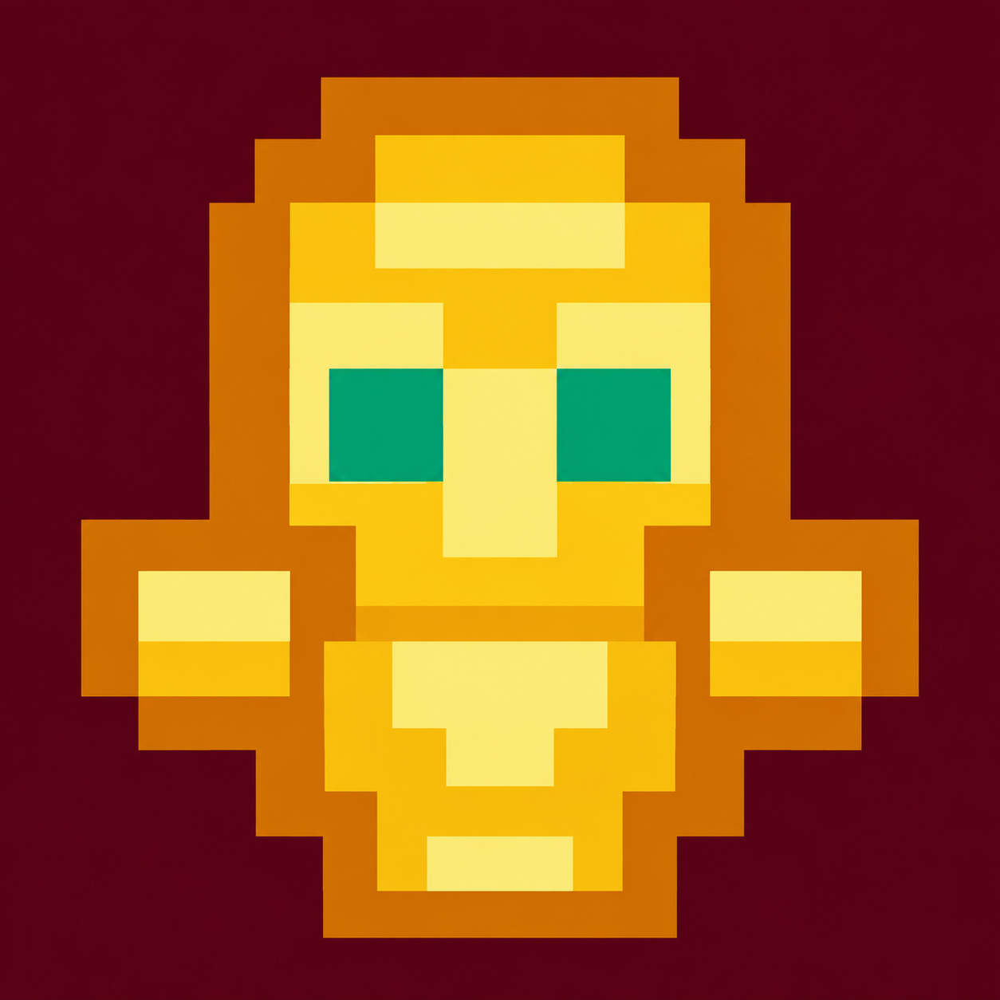

# The Basic HUD

A client-side visual HUD for [Horizon](https://playhorizon.dev). **Move it. Size it. Make it yours.**

Fourteen independent widgets: effects, consumables, durability, totem uses, available player health, item cooldowns, coordinates, FPS, ping, speed, CPS, world clock, mini armour and recent item pickups. Arrange them directly over the game, tune each style, or use compact icons with useful values. Includes a customizable Tab list and ten interface languages.

## 0.5.0 — Recent pickups

[English update notes with Russian, Ukrainian, German, French and Spanish summaries](CHANGELOG.md). A new movable widget shows the items you picked up: collect four torches, then two more before the entry expires, and it reads **Torch x6**. Each repeat pickup refreshes that item's timer. The default is **5 seconds**, adjustable from **1 to 60 seconds** in the editor. Supports icon + count mode, scaling and colours. This release also introduces the selected pixel-art totem icon.

## Install

Download [basic_hud-0.5.0.hnmod](https://github.com/repositorykreml1n/the-basic-hud/releases/download/v0.5.0/basic_hud-0.5.0.hnmod). Install through Horizon's native-mod manager and build with **Performance / Производительная сборка**. The archive contains Rust source; the launcher compiles it into a native instance.

**Pinned compatibility:** Minecraft26.3, Horizon `68ac6f647e7022b2c696e81863d7cface28c9416`, horizon-mixins `0d6b103c70633d8fd9443d8d0acd3aadaacedb06`. Do not assume other Nightlies are supported. Dev startup can overflow the stack on this Windows baseline; use Performance.

## Controls

- Right Shift (rebindable), or Options > Mods > The Basic HUD > Settings > Edit HUD.
- Drag to move; wheel/control buttons to resize; arrows to nudge; snap to align.
- Tab hides editor controls; ? replays the first-visit tutorial.
- Save writes changes. Leaving with edits asks Save / Discard changes / Stay. Enter saves and Esc stays in that dialog.
- Reset requires confirmation and changes the draft until saved.

## Data boundaries

This is visual and client-side. It reads only data the client already has. Missing player health remains unknown. Totem uses outside the client's observation cannot be counted; counts reset on death/leaving. Server-plugin-only cooldowns cannot be read. Single-player ping is labelled Local. Speed/CPS/clock are optional. No FPS gain is promised.

Recent pickups records confirmed ground-item collection by your player, including the accepted amount when the inventory is nearly full. `/give`, crafting and moving inventory items do not by themselves create entries. Different item components stay separate. History is kept only in memory, capped at 64 entries and cleared on death, leaving the world or disabling the widget.

Native mods run with the player's rights and are not sandboxed. Read the source before installing. No Minecraft assets or game binaries are included. This is not an official Horizon, Mojang or Microsoft product.

## Build and reproduce

Run `cargo test --locked --all-targets` for the pure logic tests (75 executions, including reused unit cases). `python tools/generate-i18n.py` validates and regenerates the 153-key catalog. `python tools/package.py` writes the deterministic .hnmod; its SHA-256 must match the release notes. For native checks, use the official [Horizon mod workflow](https://playhorizon.dev/docs/make-a-mod) against the pinned commit in compatibility.json. Native and runtime verification details are in [the release notes](docs/release-0.5.0.md).

MIT. Copyright repositorykreml1n. Icon and archived cover illustration generated with OpenAI image generation; gameplay UI in the archived illustration is promotional artwork. [Direct icon URL](https://raw.githubusercontent.com/repositorykreml1n/the-basic-hud/main/icon.png).
